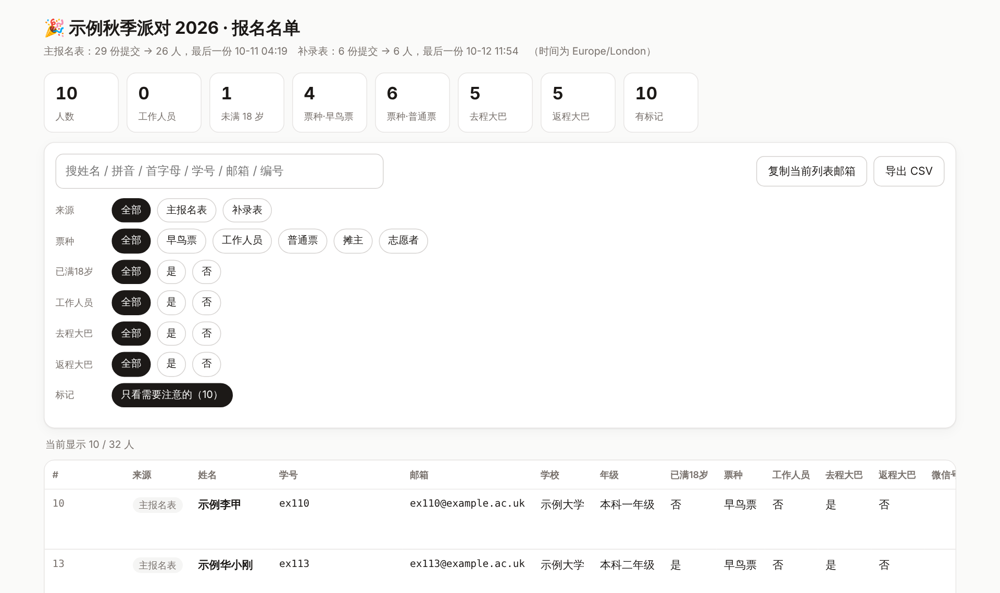
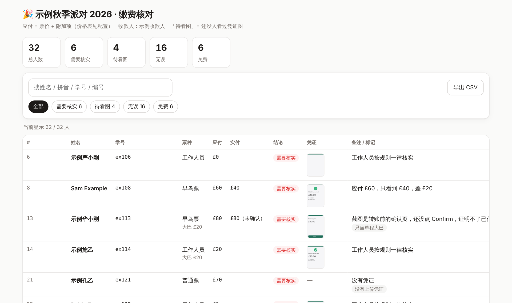
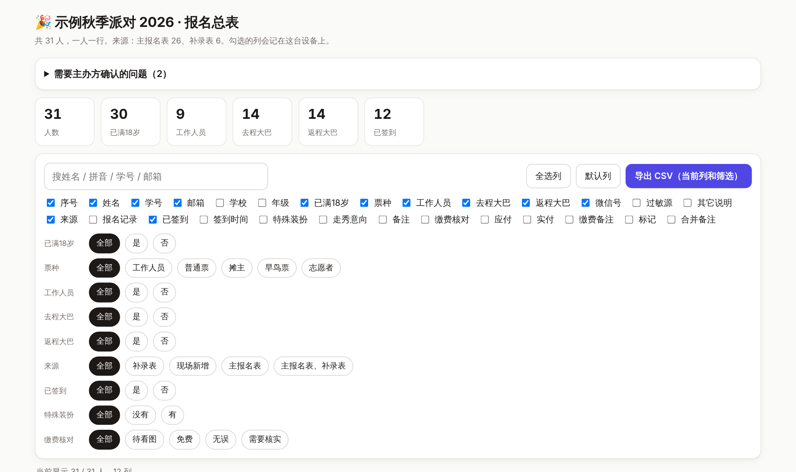
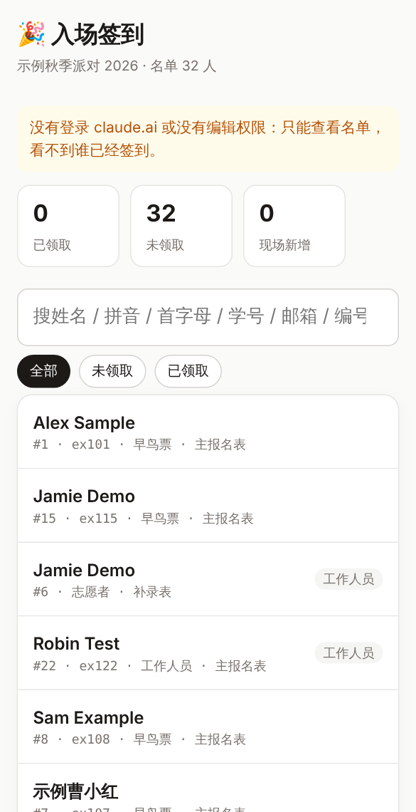

# event-registration-skill

**English** | [中文](README.zh-CN.md)

**Event registration · data cleanup · rosters · check-in · lucky draw — a one-command toolkit packaged as a Claude Skill**

Anyone who has run an event knows the pain: form exports full of `A.Yes`, the same person submitting three times, student IDs typed as email addresses, payment screenshots that don't add up, several spreadsheets that need to become one, and a chaotic check-in desk on the night.
This skill turns all of that into "edit one config file, run one command". It was built and refined on a real 100+ person event, and moving to a new event only means editing `event.json` — no code changes.

> The scripts, pages and docs are currently in Chinese (the UI text and messages). The config keys, commands and code are language-neutral, so the toolkit works for any event; labels such as field names are set in `event.json`.

## What it does

| | Feature | Output |
|---|---|---|
| 📝 | Registration form design: recommended questions, intro copy, export tips | `references/form-design.md` |
| 🧹 | Clean form exports (Tencent Wenjuan / Google Forms / any CSV or xlsx): column mapping, strip `A.` option prefixes, yes/no → boolean, time-zone conversion, dedupe by ID or email keeping the latest submission, automatic issue flags | `people.json` |
| 🖼️ | Attachments: match the form's attachment zip to each person, compress images, detect the same screenshot uploaded by different people | `proof/*.jpg` |
| 💷 | Payment check: amount due from config (ticket + add-ons such as a bus), verdicts after reviewing each screenshot, one row per person | `payment.json` + page |
| 🔗 | Multi-source merge: several forms + late sign-ups + on-site check-ins → one row per person; conflicts listed as questions for the organizers | `master.json` + `questions.md` |
| 📋 | Roster page: filters, pinyin search, copy emails, full-size proof viewer with prev/next | `list` page |
| 🎟️ | On-site check-in / wristband page: pinyin search, edits keep the original values, walk-ins, required fields, group QR code after confirming, undo, CSV export | `checkin` page |
| ☁️ | No-login check-in: the same page as a Google Apps Script web app, records written to a Google Sheet | `Code.gs` + `Index.html` |
| 📊 | Excel check-in backup for when the network fails, with dropdowns | `.xlsx` |
| 🎰 | Lucky-draw wheel: tap names into the pool, spin, re-draw if the winner isn't there | `draw` page |

## Screenshots (fictional sample data)

| Roster | Payment check |
|---|---|
|  |  |
| **Master list** | **Check-in (phone)** |
|  |  |

## Install

**As a Claude Code skill**
```bash
git clone https://github.com/EL142857/event-registration-skill ~/.claude/skills/event-registration
pip install -r ~/.claude/skills/event-registration/requirements.txt
```
Then just ask Claude things like "clean up this registration export" or "make a check-in page", and it follows the workflow in `SKILL.md`.

**On claude.ai**: zip the repository and upload it under Settings → Capabilities → Skills.

**Without Claude**: the scripts run fine on their own (plain Python, standard library plus three optional packages).

## Try it

```bash
bash scripts/run_example.sh     # generates fictional data and runs the whole pipeline
open out/名单.html out/签到.html # or open any page in out/ in a browser
```

## Use it for your own event

```bash
cp config/event.example.json config/event.json   # event name, column names, prices, check-in fields
python3 scripts/normalize.py config/event.json out/people.json
python3 scripts/proofs.py    config/event.json out/people.json attachments.zip
python3 scripts/payment.py   config/event.json out/people.json out/verdicts.json out/payment.json
python3 scripts/merge.py     config/event.json out/people.json out/master.json --payment out/payment.json
python3 scripts/render.py list    config/event.json out/people.json  out/roster.html --embed-images
python3 scripts/render.py checkin config/event.json out/people.json  out/checkin.html --qr group-qr.png
python3 scripts/render.py draw    config/event.json out/master.json  out/draw.html
```

| Step | Script | What it does |
|---|---|---|
| 1 | `normalize.py` | Reads every source in the config, maps columns, dedupes within each source, adds flags (under 18, ID typed as email, email domain typo, one-way bus only, resubmitted…) |
| 2 | `proofs.py` | Links attachment files (`<no>_q10_...` in Tencent exports) to people, resizes to 1600 px JPEG, flags shared images |
| 3 | `payment.py` | Computes amount due; merges `verdicts.json` (`ok` / `coupon` / `check` / `free`); writes `verdicts.todo.json` listing who still needs a screenshot review |
| 4 | `merge.py` | Merges sources by ID → email; same-name-only matches become questions, never auto-merged; applies `resolutions.json` answers; joins check-in records |
| 5 | `render.py` | Builds a single-file HTML page: `list`, `payment`, `master`, `checkin` (backends: Claude Artifact db, Google Apps Script, or local), `draw` |
| 6 | `checkin_xlsx.py` | Excel backup with dropdowns and blank rows for walk-ins |
| 7 | `build_gas.py` | Google Apps Script files plus step-by-step deployment notes |

See [`references/config.md`](references/config.md) for every config option.

## Layout

```
SKILL.md        Instructions Claude reads (workflow, rules, publishing)
config/         Example config
scripts/        normalize / proofs / payment / merge / render / checkin_xlsx / build_gas / make_sample
templates/      Single-file HTML pages (dark mode and phone friendly) + Apps Script backend
references/     Form design, config, payment review, publishing, Apps Script, privacy
examples/       Fictional sample data (generated by make_sample.py)
```

## Privacy

There is no real personal data in this repository; all sample data is fictional and generated by a script. `.gitignore` excludes `out/`, `data/`, `*.zip` and `config/event.json` — please never commit real registration data. See [`references/privacy.md`](references/privacy.md).

## License

MIT
